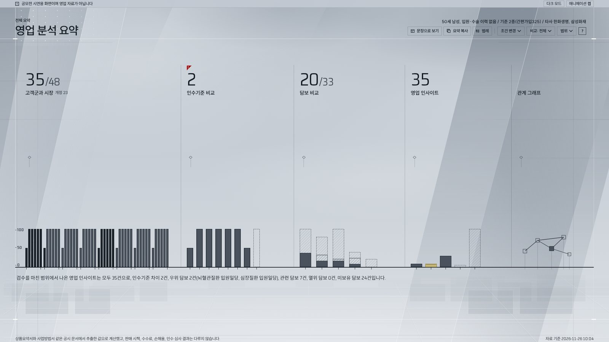
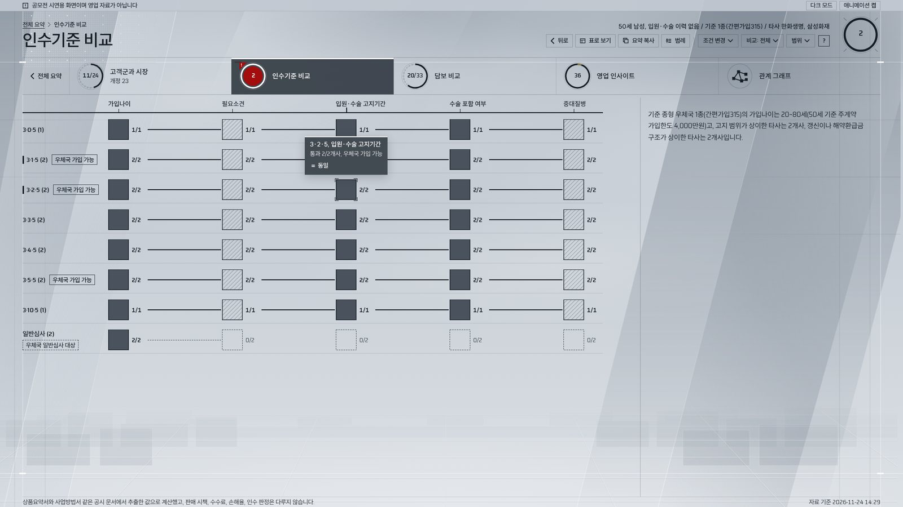
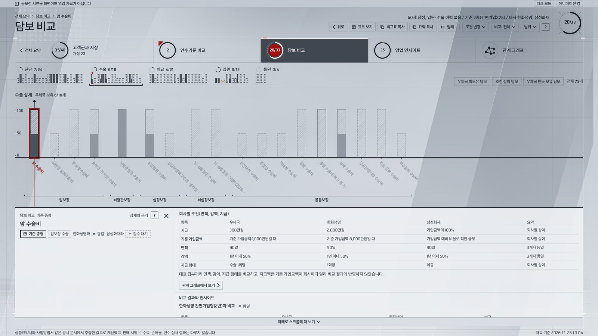

# 우체국보험 상품-영업 분석

보험회사마다 다르게 적어 놓은 상품 조건을 AI가 대신 읽어, 한 화면에서 나란히 비교할 수 있게 만든 도구입니다. 여기서 상품 조건은 "몇 살까지, 어떤 병력이 있어도 가입할 수 있는가", "암 수술비를 얼마 주는가" 같은 내용입니다. 우체국보험의 상품을 기획하고 영업을 지원하는 담당자가 "다른 보험회사 상품과 무엇이 다른가"를 문서를 일일이 뒤지지 않고 화면에서 확인하는 것이 목표입니다. AI 도구와 에이전트 활용 공모전 출품작입니다.

낯선 보험 용어는 아래 [용어 풀이](#용어-풀이)에 모았습니다.

## 바로 보기

설치할 것은 없습니다. 아래 주소를 누르면 크롬이나 엣지 같은 인터넷 브라우저에서 바로 열립니다. 컴퓨터 화면에 맞춰 만들었으니 컴퓨터로 보시기를 권합니다.

처음이시면 분석 화면부터 눌러 보세요. 전체 내용을 빠르게 보시려면 발표 자료가 좋습니다.

| 무엇 | 주소 | 설명 |
| --- | --- | --- |
| 분석 화면 | [열기](https://bluethestyle.github.io/korea_post_life/proto/console4.html) | 직접 눌러 볼 수 있는 화면입니다. 열면 전체 요약 화면이 먼저 나오고, 위쪽 메뉴를 눌러 화면을 옮겨 다닙니다. 위쪽의 "조건 변경"에서 고객의 나이와 병력을 바꿔 가며 회사별 차이를 봅니다 |
| 발표 자료 | [열기](https://bluethestyle.github.io/korea_post_life/deck/) | 26장입니다. 키보드 방향키로 넘기고, 설명 영상 네 편이 들어 있습니다 |
| 안내 화면 | [열기](https://bluethestyle.github.io/korea_post_life/) | 위 두 가지와 그 밖의 화면으로 가는 첫 화면입니다 |

> 화면에 나오는 "가입 가능"은 공개된 문서만 보고 낸 참고 결과입니다. 실제 가입 심사 결과가 아닙니다.

분석 화면을 열면 처음 보이는 전체 요약 화면입니다.

## 무엇을 하는 도구인가요

- **하는 일:** 보험회사가 홈페이지에 공개한 상품 문서를 모아, 그 안의 가입 조건과 보장 내용을 표로 정리하고 회사별로 나란히 보여 줍니다.
- **쓰는 사람:** 우체국보험의 상품 기획과 영업 지원 담당자입니다. 고객에게 나눠 주는 자료가 아니라, 담당자가 내부에서 비교하고 판단할 때 보는 참고 자료입니다.
- **지금 볼 수 있는 범위:** 우체국보험, 한화생명, 삼성화재 세 회사의 상품 종류 23개입니다. 이 가운데 보장 내용까지 비교하는 것은 16개입니다.

## 왜 만들었나요

보험 상품의 조건은 각 회사가 공개하는 문서(상품요약서, 사업방법서, 약관)에 글로 적혀 있습니다. 여기서 세 가지 어려움이 생깁니다.

1. **문서가 깁니다.** 상품 하나의 문서가 수백 쪽입니다.
2. **회사마다 용어가 다릅니다.** 같은 보장도 회사마다 이름이 다르고, 보험금을 주지 않는 기간이나 줄여서 주는 기간 같은 조건도 제각각입니다.
3. **손으로 찾아 맞춰야 합니다.** 실무자 관점에서 소요시간을 어림잡아 보면, 다른 회사 상품 하나를 비교표로 정리하는 데 2~3일이 걸리고 분기에 한두 번 이 일을 합니다(어림한 값이고 측정한 값은 아닙니다).

## 이 도구가 대신 해 주는 일

| 순서 | 사람이 하던 일 | 이 도구가 하는 일 |
| --- | --- | --- |
| 1 | 회사 홈페이지에서 문서를 찾아 내려받기 | 공개된 문서를 자동으로 받아 옵니다 |
| 2 | 수백 쪽에서 금액과 조건이 적힌 문장 찾기 | AI가 문장을 찾아 표로 옮기고, 어느 문서 몇 쪽에서 왔는지 함께 남깁니다. 표가 규칙적으로 짜인 문서(삼성화재)는 AI 없이 프로그램이 직접 읽습니다 |
| 3 | 옮겨 적은 값이 맞는지 다시 확인하기 | 다른 AI와 프로그램이 원문과 한 번 더 대조합니다. 확신이 낮은 값은 "검수 대기"(사람이 확인하기 전까지 확정하지 않은 값)로 따로 둡니다 |
| 4 | 회사마다 다른 보장 이름 맞추기 | 담당자가 정한 표준 보장 이름 80여 개(예: 암 수술비)에 연결해 같은 보장끼리 모읍니다 |
| 5 | 비교표와 설명 자료 만들기 | 비교 화면과 인쇄용 A4 한 장(응대 화법)으로 보여 줍니다 |

## 화면 둘러보기

분석 화면 위쪽에는 메뉴 여섯 개가 있습니다. 담당자가 일하는 순서대로 네 단계로 묶었습니다.

| 단계 | 화면 | 여기서 알 수 있는 것 |
| --- | --- | --- |
| 1. 넓게 보기 | 전체 요약 | 지금 고른 조건에서 화면마다의 핵심 결과를 한눈에 봅니다 |
| 1. 넓게 보기 | 고객군과 시장 | 나이와 병력으로 나눈 고객 유형마다 어느 회사에 가입할 수 있는지, 최근 보험 시장에 어떤 변화가 있었는지 봅니다 |
| 2. 좁혀 확인 | 인수기준 비교 | 가입할 수 있는 나이, 건강에 관한 질문 같은 가입 조건이 회사마다 어떻게 다른지 봅니다 |
| 2. 좁혀 확인 | 담보 비교 | 같은 보장에 회사마다 얼마를, 어떤 조건으로 주는지 봅니다 |
| 2. 좁혀 확인 | 관계 그래프 | 회사, 상품, 보장이 서로 어떻게 이어져 있는지 그림으로 봅니다 |
| 3. 결론 | 영업 인사이트 | 우체국 상품이 앞서는 점과 보완할 점을 봅니다 |
| 4. 내보내기 | 응대 화법(영업 인사이트 화면 안) | 고른 항목을 인쇄하거나 복사할 수 있는 A4 한 장으로 정리합니다 |

고객의 나이와 병력 조건을 바꾸면 가입할 수 있는 회사가 바로 바뀝니다.

암 수술비 하나를 세 회사 문서에서 찾아 같은 행에 놓고 비교합니다.

## AI가 틀리면 어떻게 하나요

AI는 그럴듯하게 틀릴 수 있습니다. 그래서 AI의 답을 그대로 믿지 않도록 만들었습니다.

- **AI는 글자만 옮깁니다.** 금액과 기간은 문서에 적힌 글자 그대로 가져오고, 계산은 프로그램이 합니다.
- **원문과 다시 대조합니다.** 옮긴 값이 문서의 그 쪽에 실제로 있는지 프로그램이 확인합니다. 이어서 판정만 하는 다른 AI가 그 값이 맞을 가능성을 점수로 매깁니다.
- **확신이 낮으면 사람에게 넘깁니다.** 점수가 낮은 값은 "검수 대기"로 표시하거나 화면에 싣지 않습니다.
- **기준은 사람이 정합니다.** 어떤 보장을 같은 것으로 볼지, 점수가 얼마 이상이어야 믿을지는 담당자가 정합니다.

실제로 확인한 결과입니다.

- 우체국 상품요약서 2건에서 맞는 값을 일부러 틀리게 바꿔 시험용 오류 437건을 만들어 넣어 보았습니다. 이 가운데 자동으로 확정된 것은 0건이었습니다. 다만 표본이 좁아 다른 회사 문서로는 더 확인해야 합니다.
- 프로그램이 제대로 동작하는지 확인하는 자동 점검 1,500여 개가 프로그램을 고칠 때마다 실행됩니다.

수치의 근거는 [제출 설명](docs/submission.md)의 성과 지표 절과 발표 자료에 있습니다.

## AI를 어떻게 썼나요

사람 한 명이 방향을 정하고, AI 여럿이 일을 나눠 맡았습니다. 아래 표에서 "만들 때"는 이 도구를 개발하는 과정이고, "도구가 일할 때"는 완성된 도구가 문서를 읽고 정리하는 과정입니다.

| 언제 | AI | 맡긴 일 |
| --- | --- | --- |
| 만들 때 | Claude Code(Anthropic의 AI 개발 도구)와 그 아래의 보조 AI들 | 작업 순서 정하기, 프로그램 작성, 점검, 결과 검수 |
| 만들 때 | Gemini(Google의 AI) | Claude가 낸 결과를 따로 다시 확인하기, 자료 조사 |
| 만들 때 | Antigravity(Google의 AI 개발 도구) | 화면 만들기 |
| 도구가 일할 때 | Gemini 모델 | 문서를 읽어 표로 옮기기, 시장 동향 모으기 |
| 도구가 일할 때 | 판정 전용 AI | 글을 쓰지 않고 점수만 매깁니다. 옮긴 값이 맞는지, 회사마다 다른 보장 이름이 같은 보장인지, 모은 소식이 쓸 만한지를 봅니다 |

## 지금 들어 있는 자료

2026년 11월 24일에 정리한 자료 기준입니다.

| 항목 | 수 |
| --- | --- |
| 화면에서 비교하는 회사 | 3곳(우체국보험, 한화생명, 삼성화재) |
| 상품 종류(종형) | 23개(보장 내용까지 비교하는 것은 16개) |
| 주계약과 특약 | 2,747개 |
| 보장 항목(급부) | 6,615건 |
| 시장 동향을 모으는 보험회사 | 19곳(생명보험 9곳, 손해보험 9곳, 우체국보험) |

아직 화면에는 없지만 삼성생명, KB라이프생명, 메리츠화재의 자료도 정리해 두었습니다. 확인을 마치는 대로 화면에 차례로 넣을 예정입니다.

## 알아 두실 점

- 화면의 "가입 가능"은 공개된 문서의 조건만으로 본 결과입니다. 실제 가입 심사 결과가 아닙니다.
- 내부 교육과 비교에 쓰는 참고 자료이며, 고객에게 배포하는 자료가 아닙니다.
- 공개된 문서만 썼습니다. 특약별 보험료처럼 문서에 없는 값은 비교하지 않습니다.
- 이 도구로 업무 시간이 얼마나 줄어드는지는 아직 측정하지 않았습니다.
- 더 자세한 한계는 [알려진 한계](docs/limitations.md)에 적었습니다.

## 용어 풀이

| 말 | 뜻 |
| --- | --- |
| 공시 문서 | 보험회사가 상품마다 홈페이지에 공개하는 문서입니다. 상품요약서, 사업방법서, 약관이 있습니다 |
| 주계약과 특약 | 주계약은 상품의 기본 보장이고, 특약은 골라서 더하는 보장입니다 |
| 담보 | 암 진단비, 수술비처럼 보장 하나하나를 가리키는 말입니다. 이 글의 "보장"과 같은 뜻입니다 |
| 급부 | 어떤 경우에 얼마를 주는지 정한 지급 항목입니다 |
| 종형 | 같은 상품 안에서 가입 방식이나 보장 구성에 따라 나뉜 종류입니다 |
| 간편심사 | 건강에 관한 질문 수를 줄여 가입 문턱을 낮춘 심사 방식입니다 |
| 인수기준 | 보험회사가 가입을 받아 줄지 정하는 기준입니다. 나이, 병력에 관한 질문이 여기에 듭니다 |
| 면책기간 | 가입 뒤 일정 기간 동안 보험금을 주지 않는 기간입니다 |
| 감액기간 | 가입 뒤 일정 기간 동안 보험금을 줄여서 주는 기간입니다 |
| 검수 대기 | AI가 옮긴 값 가운데 확신이 낮아, 사람이 확인하기 전까지 확정하지 않은 값입니다 |
| 응대 화법 | 영업 인사이트 화면에서 고른 항목을 A4 한 장으로 모은 내부 참고 자료입니다. 담당자가 고객 문의에 답할 때 참고하며, 고객에게 나눠 주는 자료는 아닙니다 |

## 더 알고 싶다면

| 궁금한 것 | 문서 |
| --- | --- |
| 무엇을 왜 이렇게 만들었는지(공모전 제출 설명) | [docs/submission.md](docs/submission.md) |
| 알려진 한계 | [docs/limitations.md](docs/limitations.md) |
| 개발자를 위한 안내(구조, 실행 방법, 자동 실행 일정) | [docs/developer.md](docs/developer.md) |
| 설계 문서 | [docs/planning.md](docs/planning.md) |
| 진행 기록 | [docs/progress.md](docs/progress.md) |
